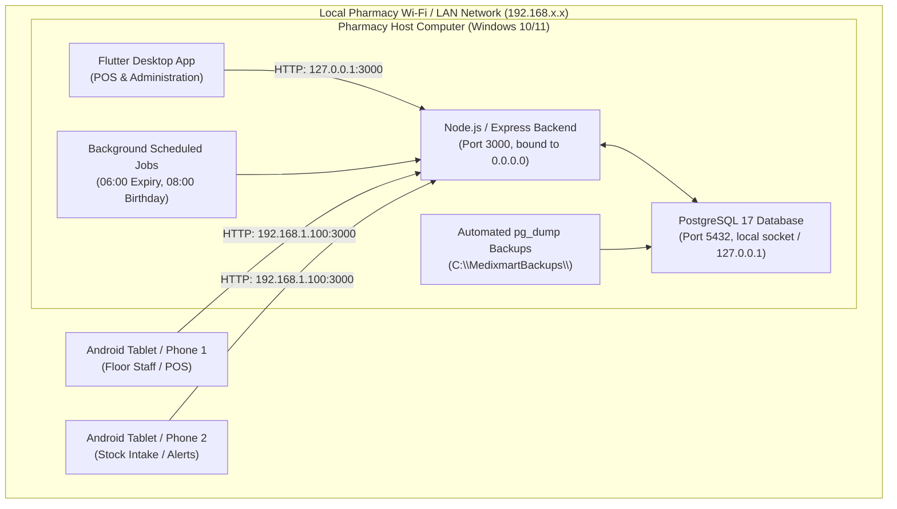

# Medixmart Plus — Architecture & API Conventions

**Document Version:** 1.0.0  
**Effective Date:** 2026-11-05  
**Owner:** Member 1 (System Architect & Backend Lead)  
**Stakeholders:** Member 2 (Frontend), Member 3 (Inventory), Member 4 (POS/Sales), Member 5 (Customers/Messaging), Member 6 (QA/Reports)

---

## 1. System Topology & Network Architecture

Medixmart Plus employs an on-premise, local-first architecture to guarantee continuous operation without dependency on external cloud connectivity.



### Key Architectural Constraints:
1. **Server Bind Address:** Express binds to `0.0.0.0:3000` so mobile and desktop devices on the local pharmacy subnet can access the API.
2. **Database Isolation:** PostgreSQL listens on `127.0.0.1:5432`. No external firewall ports are opened for PostgreSQL directly; all database operations are mediated by the Express backend.
3. **Host Static IP:** The host computer must have a reserved DHCP lease or static IP address (e.g. `192.168.1.100`). Clients configure this address in application settings.

---

## 2. Standardized HTTP Request & Response Envelopes

Every API endpoint must strictly adhere to the standardized JSON envelope. Clients (Flutter) rely on these predictable structures for deserialization.

### 2.1 Request Headers
Every authenticated request must include:
```http
Content-Type: application/json
Authorization: Bearer <jwt_token>
```

### 2.2 Success Response Envelope (`HTTP 200 / 201`)
```json
{
  "success": true,
  "data": {
    "id": 14,
    "name": "Amoxicillin 500mg",
    "selling_price": 25.50
  },
  "meta": {
    "timestamp": "2026-11-05T12:00:00.000Z"
  }
}
```

### 2.3 Paginated List Response Envelope (`HTTP 200`)
```json
{
  "success": true,
  "data": [
    { "id": 1, "name": "Paracetamol 500mg", "selling_price": 5.00 },
    { "id": 2, "name": "Amoxicillin 500mg", "selling_price": 25.50 }
  ],
  "meta": {
    "page": 1,
    "limit": 20,
    "totalRecords": 145,
    "totalPages": 8,
    "hasNextPage": true,
    "hasPrevPage": false,
    "timestamp": "2026-11-05T12:00:00.000Z"
  }
}
```

### 2.4 Error Response Envelope (`HTTP 4xx / 5xx`)
```json
{
  "success": false,
  "error": {
    "code": "VALIDATION_ERROR",
    "message": "Invalid input provided for the medicine.",
    "details": [
      {
        "field": "selling_price",
        "message": "Selling price must be greater than zero."
      }
    ],
    "timestamp": "2026-11-05T12:00:00.000Z"
  }
}
```

> [!IMPORTANT]
> In production mode (`NODE_ENV=production`), server errors (`500`) must never expose stack traces, database credentials, internal SQL queries, or filesystem paths.

---

## 3. Standard HTTP Status Codes & Error Taxonomy

| HTTP Code | Purpose | Common Error Codes |
| :---: | :--- | :--- |
| **200 OK** | Successful read, update, or action | — |
| **201 Created** | Successful entity creation | — |
| **204 No Content** | Successful deletion or action with no response body | — |
| **400 Bad Request** | Malformed JSON or generic invalid client input | `BAD_REQUEST`, `MALFORMED_JSON` |
| **401 Unauthorized** | Missing, expired, or invalid JWT token | `AUTH_MISSING_TOKEN`, `AUTH_EXPIRED_TOKEN`, `AUTH_INVALID_TOKEN`, `AUTH_INVALID_CREDENTIALS` |
| **403 Forbidden** | Authenticated user lacks required role or account disabled | `AUTH_FORBIDDEN_ROLE`, `AUTH_ACCOUNT_DISABLED` |
| **404 Not Found** | Requested resource or route does not exist | `ROUTE_NOT_FOUND`, `ENTITY_NOT_FOUND` |
| **409 Conflict** | Duplicate resource (e.g. existing username or barcode) | `DUPLICATE_ENTRY`, `RESOURCE_CONFLICT` |
| **422 Unprocessable** | Semantic validation failures (e.g. insufficient stock) | `VALIDATION_ERROR`, `STOCK_INSUFFICIENT`, `BATCH_EXPIRED` |
| **429 Too Many Req** | Rate limit exceeded (e.g. login brute force) | `RATE_LIMIT_EXCEEDED` |
| **500 Server Error** | Unhandled internal backend exceptions | `INTERNAL_SERVER_ERROR`, `DATABASE_ERROR` |
| **503 Unavailable** | Database unreachable or system undergoing maintenance | `SERVICE_UNAVAILABLE`, `DATABASE_UNAVAILABLE` |

---

## 4. Data Types, Business Rules & Integrity Standards

### 4.1 Monetary Amounts & Currency Rules
1. **Server-Authoritative Pricing:** The server is the sole authority for item prices, sub-totals, discounts, taxes, and final bill totals. The client passes selected `medicine_id`, requested `quantity`, and any authorized discount parameters. The server re-computes all amounts from stored prices.
2. **Precision & Storage:** Currency values must be stored in PostgreSQL as `NUMERIC(10, 2)`.
3. **JSON Representation:** Monetary numbers are serialized as numeric decimals (e.g., `125.50`) or strings with 2 decimal places to prevent client floating-point rounding errors.
4. **Rounding Policy:** Standard half-up rounding (`Math.round((cents + Number.EPSILON))`) applied strictly to 2 decimal places at line-item and bill totals.

### 4.2 Expiry-First (FEFO) Stock Allocation
1. **Naming Standard:** The allocation strategy is formally designated **FEFO** (First Expired, First Out) across all documentation, code variables, and SQL scripts.
2. **Allocation Order:** During checkout, requested quantities are deducted sequentially from active batches ordered by:
   ```sql
   ORDER BY expiry_date ASC, id ASC
   ```
3. **Traceability:** Every sold item (`sale_items` row) must link directly to the specific `batch_id` from which it was deducted. Multi-batch splits must generate separate `sale_items` rows.
4. **Ineligibility:** Batches that are expired (`expiry_date < CURRENT_DATE`), inactive (`is_active = false`), or with zero stock (`quantity = 0`) must never enter the allocation candidate set.

### 4.3 Date, Time & Timezone Standards
1. **System Timezone:** The operational timezone is locked to `Asia/Colombo` (UTC+05:30).
2. **Timestamps:** Transmitted over the API as standard ISO 8601 strings with UTC offset: `YYYY-MM-DDTHH:mm:ss.sssZ`.
3. **Date-Only Fields:** Batch expiry dates and customer birthdays are stored and transmitted as calendar dates: `YYYY-MM-DD`.
4. **Expiry Date Boundary:** A medicine batch expiring on `2026-11-05` is deemed **valid until 23:59:59** of that local day. It is treated as expired starting from `00:00:00` on `2026-11-06`.

### 4.4 Pagination, Sorting & Query Conventions
List endpoints support the following uniform query parameters:
- `page` (integer, default: `1`): 1-indexed page number.
- `limit` (integer, default: `20`, maximum: `100`): Number of records per page.
- `search` (string, optional): Case-insensitive partial matching (`ILIKE %search%`).
- `sortBy` (string, optional): Column name to sort by (must be validated against an allowed whitelist).
- `sortOrder` (string, optional, `asc` | `desc`, default: `desc`).

---

## 5. Role-Based Access Control (RBAC) Matrix

| Module / Operation | HTTP Route | Allowed Roles | Description |
| :--- | :--- | :---: | :--- |
| **Authentication** | `POST /api/auth/login` | Public | Authenticate with username and password |
| | `PUT /api/auth/change-password` | Admin, Pharmacist | Change own password |
| **System Health** | `GET /api/health` | Public | System status and DB readiness check |
| **Administration** | `GET /api/admin/users` | Admin | List system accounts |
| | `POST /api/admin/users` | Admin | Create user with assigned role |
| | `PUT /api/admin/users/:id` | Admin | Update user details or role |
| | `PATCH /api/admin/users/:id/disable` | Admin | Deactivate user (self-lockout blocked) |
| | `GET /api/admin/settings` | Admin | Read system settings and thresholds |
| | `PUT /api/admin/settings` | Admin | Update configuration parameters |
| **Inventory** | `GET /api/categories` | Admin, Pharmacist | List medicine categories |
| | `POST /api/categories` | Admin | Create new category |
| | `GET /api/medicines` | Admin, Pharmacist | Search medicines and available stock |
| | `POST /api/medicines` | Admin | Add new medicine |
| | `PUT /api/medicines/:id` | Admin | Edit medicine details or reorder level |
| | `PATCH /api/medicines/:id/deactivate` | Admin | Soft-deactivate medicine |
| **Suppliers & Stock**| `GET /api/suppliers` | Admin, Pharmacist | Search and list suppliers |
| | `POST /api/suppliers` | Admin | Add new supplier |
| | `GET /api/batches` | Admin, Pharmacist | List batches per medicine |
| | `POST /api/batches` | Admin, Pharmacist | Receive stock batch (purchase intake) |
| **Sales & POS** | `POST /api/sales` | Admin, Pharmacist | Process checkout & FEFO batch deduction |
| | `GET /api/sales/:id` | Admin, Pharmacist | View receipt details |
| **Customers & Credit**| `GET /api/customers` | Admin, Pharmacist | Directory and balance lookup |
| | `POST /api/customers` | Admin, Pharmacist | Register new customer |
| | `POST /api/credit/payments` | Admin, Pharmacist | Record credit balance repayment |
| **Alerts** | `GET /api/alerts` | Admin, Pharmacist | List active expiry and low-stock alerts |
| | `PATCH /api/alerts/:id/read` | Admin, Pharmacist | Mark alert as acknowledged/read |
| **Reports** | `GET /api/reports/dashboard` | Admin, Pharmacist | Summary KPI cards |
| | `GET /api/reports/sales` | Admin | Detailed sales analytics & exports |

---

## 6. Endpoint Ownership & Delivery Matrix

| Owner | Subsystem | Core Responsibilities |
| :---: | :--- | :--- |
| **Member 1** | Foundation, Auth & Admin | Server bootstrap, DB pool, `/api/health`, `/api/auth/*`, `/api/admin/*`, expiry cron, backup tooling. |
| **Member 2** | UI/UX & Client Integration | Flutter app shell, desktop/mobile responsive UI, central API service, local JWT storage. |
| **Member 3** | Inventory & Batches | Relational DB schema, `/api/categories`, `/api/medicines`, `/api/batches`, `/api/alerts`. |
| **Member 4** | POS & Billing Engine | `/api/sales` atomic FEFO checkout, row locks (`FOR UPDATE`), PDF receipt generation. |
| **Member 5** | Customers & Messaging | `/api/customers`, `/api/credit/*`, daily birthday notification job, messaging service. |
| **Member 6** | QA, Reports & Audit | `/api/reports/*`, CSV/Excel exports, integration/load tests, backup restore verification, UAT. |

