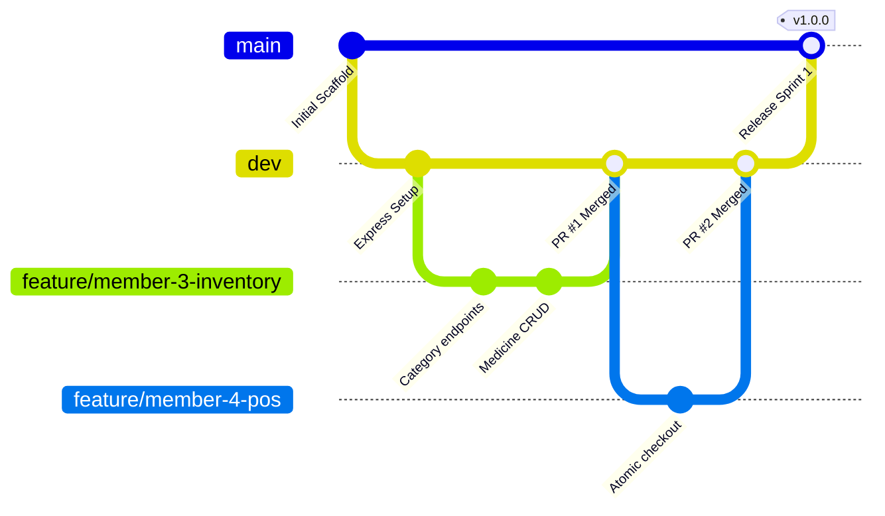

# Backend Integration & Pull Request Review Guidelines

**Owner:** Member 1 (System Architect & Backend Lead)  
**Applicable to:** All team members contributing backend code (Members 1, 3, 4, 5, 6).

---

## 1. Git Branching Strategy

To maintain a stable, deployable codebase, all members must adhere to the three-tier branching model:

1. **`main` Branch:**
   - Production-ready releases only.
   - Direct pushes forbidden. Merges only from `dev` after Sprint sign-off and QA verification by Member 6.
2. **`dev` Branch:**
   - Shared integration branch.
   - All feature branches branch off and target `dev`.
3. **`feature/member<X>-<short-description>` Branches:**
   - Example: `feature/member3-medicine-crud`, `feature/member4-pos-checkout`.
   - Rebase or merge latest `dev` before opening a PR.

---

## 2. Mandatory Pull Request Review Checklist

Before any backend PR is merged into `dev`, Member 1 and the respective peer reviewers must verify each requirement:

### 2.1 Security & Database Safety
- [ ] **SQL Injection Prevention:** Every dynamic SQL query uses PostgreSQL parameterization (`$1, $2, ...`). Zero string concatenation or template literal interpolation in SQL strings.
- [ ] **Connection Lifecycle:** Every acquired pool client (`getClient()`) is guaranteed to be released via `client.release()` inside a `finally` block.
- [ ] **Transaction Atomicity:** Multi-step writes (especially batch deduction and credit adjustments) run inside a single transaction (`BEGIN` -> `COMMIT` -> `ROLLBACK` on error).
- [ ] **Pessimistic Concurrency:** Stock allocation queries use row-level locking (`FOR UPDATE`) in consistent lock order.
- [ ] **Soft Deactivation:** Master entities (medicines, users) are soft-disabled (`is_active = false`) rather than deleted, preserving foreign key integrity for sales history.

### 2.2 API Contract & Error Adherence
- [ ] **Envelope Standard:** Responses use helper functions from `src/utils/response.js` (`successResponse`, `paginatedResponse`, `errorResponse`).
- [ ] **Error Masking:** Production responses never return raw database error messages, stack traces, or SQL queries.
- [ ] **Async Handling:** Controllers use `asyncHandler` or promise propagation so rejected promises reach the centralized error middleware.
- [ ] **HTTP Status Codes:** Uses semantic codes (e.g., 201 for creation, 400 for bad input, 401 for unauthorized, 403 for role mismatch, 404 for missing entity, 422 for domain rules).

### 2.3 Secret Protection
- [ ] **No Hardcoded Credentials:** No passwords, token secrets, API keys, or private IP addresses are committed to source control.
- [ ] **Clean Git Diff:** Diff contains only files relevant to the feature. No accidental `.env`, editor config, or `node_modules` modifications.

### 2.4 Testing & Verification
- [ ] **Automated Test Included:** PR includes unit or integration tests under `tests/unit/` or `tests/integration/`.
- [ ] **Green Build:** All existing tests run and pass without failure (`npm test`).

---

## 3. Pull Request Template

The GitHub Pull Request template is established in `.github/PULL_REQUEST_TEMPLATE.md` to ensure developers self-certify these criteria when opening PRs.

