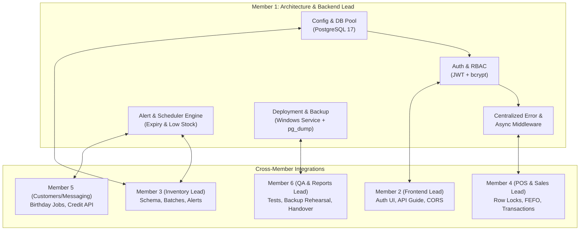

# Member 1: System Architect & Backend Lead — Master Task List

**Role:** System Architect & Backend Lead  
**Scope:** Express.js Backend, PostgreSQL Database, Security & RBAC, Scheduled Jobs, API Contracts, System Integration, and On-Premise Pharmacy Deployment.  
**Baseline Reference:** [Six Member Task Table](../../temp-docs/medixmart_plus_six_member_task_tables.pdf) & [Member 1 Foundation Document](member-1-foundation.md).

---

## Executive Summary & Ownership Boundaries

As Member 1, your core mission is to establish and protect the architectural backbone of Medixmart Plus. While other members build individual domain slices (Inventory, Sales/POS, Customers/Messaging, QA/Reporting), Member 1 owns:
1. **Express & Database Foundation:** Connection pooling, configuration loading, health checks, centralized async error handling, and safe logging.
2. **Security & Session Lifecycle:** Bcrypt hashing, 8-hour JWT issuance, Bearer authentication middleware, Admin/Pharmacist RBAC, session invalidation, and password updates.
3. **API Architecture & Contracts:** Shared response envelopes, error standardization, CORS, pagination standards, and the Flutter API integration guide.
4. **Automated Business Logic & Alert Engines:** Database/service level 7-month expiry alert calculation (`generate_expiry_alerts()`), low-stock threshold triggers, and automated cron/startup jobs.
5. **Concurrency & Integrity Reviews:** Ensuring sale batch deductions use row locks (`FOR UPDATE`), run in single atomic transactions, adhere to Expiry-First (FEFO) order, and coordinate with credit updates.
6. **Deployment, Backup & Handover:** Packaging the backend as an auto-starting Windows service on the pharmacy host computer, securing local Wi-Fi connectivity for Flutter desktop/mobile clients, automated `pg_dump` backups, restore verification, and final credential handover.

---

## Status Legend
- [x] **Completed:** Verified and implemented.
- [ ] **Ready for Implementation / In Progress:** Dependencies met or active.
- [ ] **Blocked / Awaiting Sprint:** Dependent on prerequisite member deliverables.
- `(+)` **Proposal-Gap Task:** Critical capability identified during blueprint gap analysis.

---

## Sprint 1: Foundation, Architecture & Authentication (Weeks 1 – 2)

### Week 1: Backend Foundation & Architecture Alignment
*Target Milestone: Express initialized, DB connected via pool, and API conventions locked across all 6 members.*

- [x] **M1-W1-00: Pre-requisite Environment Setup** *(Completed in [member-1-foundation.md](member-1-foundation.md))*
  - [x] Verified Git (2.55/2.56), Node.js (v24/v26), npm (11.19/11.20), PostgreSQL 17.11, and pgAdmin 4.
  - [x] Development credentials secured with DPAPI in `secrets/postgres-development.xml`.
  - [x] Confirmed folder structure and directories in `medixmart-backend/src/`.

- [x] **M1-W1-01: Bootstrap Express and Configuration**
  - **Deliverable:** Initialized Node.js backend package in [`medixmart-backend/`](../../medixmart-backend/).
  - **Action Items:**
    - [x] Initialize `package.json` with scripts (`dev`, `start`, `test`).
    - [x] Install core dependencies: `express`, `pg`, `dotenv`, `cors`, `helmet`, `bcrypt`, `jsonwebtoken`, `node-cron`, and `supertest`.
    - [x] Create `src/config/environment.js` with strict startup validation for required `.env` variables (`PORT`, `DB_HOST`, `DB_PORT`, `DB_NAME`, `DB_USER`, `DB_PASSWORD`, `JWT_SECRET`).
    - [x] Create tracked `.env.example` and ensure `.env` is Git-ignored.
    - [x] Create PostgreSQL connection pool in `src/config/db.js` using application credentials with health test & graceful pool shutdown.
    - [x] Implement `/api/health` checking HTTP availability and database connectivity (`SELECT NOW()`).
  - **Dependencies:** M3 base schema connection.
  - **Verification:** Verified `GET /api/health` returns `200 OK` with database status `healthy` and PostgreSQL time (`SELECT NOW()`). Verified via integration test `tests/integration/run_health_test.js`.

- [x] **M1-W1-02: Agree Architecture and API Conventions**
  - **Deliverable:** Published API convention standard in [`docs/api/conventions.md`](../api/conventions.md) and response utility in [`medixmart-backend/src/utils/response.js`](../../medixmart-backend/src/utils/response.js).
  - **Action Items:**
    - [x] Document local-server deployment topology (Windows host server + Wi-Fi LAN clients).
    - [x] Establish standardized JSON envelope (`success`, `data`, `meta`, `error` with `code`, `message`, `details`).
    - [x] Define HTTP status code usage (200, 201, 204, 400, 401, 403, 404, 409, 422, 429, 500, 503).
    - [x] Agree monetary precision (`NUMERIC(10,2)`, 2-decimal half-up rounding), Expiry-First (FEFO) naming, and timezone rules (`Asia/Colombo`, UTC+05:30).
    - [x] Document RBAC matrix (`Admin` vs `Pharmacist`) and endpoint ownership across all six members.
    - [x] Implement standardized response builders in `src/utils/response.js` and connect to `src/app.js`.
  - **Dependencies:** All members.
  - **Verification:** Signed off and published in [`docs/api/conventions.md`](../api/conventions.md); verified via automated 404/health tests.

- [x] **M1-W1-03: Establish Integration and Review Process**
  - **Deliverable:** Git workflow and backend PR checklist in [`docs/project-management/backend-pr-checklist.md`](backend-pr-checklist.md), template in [`.github/PULL_REQUEST_TEMPLATE.md`](../../.github/PULL_REQUEST_TEMPLATE.md), and onboarding guide in [`medixmart-backend/README.md`](../../medixmart-backend/README.md).
  - **Action Items:**
    - [x] Establish branching model (`main`, `dev`, `feature/*`).
    - [x] Create backend PR review guidelines (parameterized SQL, transaction safety, error handling, no hardcoded secrets).
    - [x] Write local developer onboarding guide in `medixmart-backend/README.md`.
    - [x] Create standardized GitHub PR template `.github/PULL_REQUEST_TEMPLATE.md`.
  - **Dependencies:** M6 repository setup.
  - **Verification:** PR template in place; verified with `git status` that `.env` and development secrets are excluded from Git commits.

---

### Week 2: Authentication, Authorization & Client Handshake
*Target Milestone: Secure login, 8-hour JWTs, Admin/Pharmacist role enforcement, and Flutter AuthProvider connection.*

- [x] **M1-W2-01: Implement Login and Admin Seed**
  - **Deliverable:** Working `/api/auth/login` endpoint and idempotent admin seeding script.
  - **Action Items:**
    - [x] Coordinate `users` table schema with Member 3 in [`src/sql/01_create_users_table.sql`](../../medixmart-backend/src/sql/01_create_users_table.sql) (`id`, `username`, `password_hash`, `role`, `is_active`, `created_at`, `updated_at`).
    - [x] Write idempotent seed script [`src/sql/seed_admin.js`](../../medixmart-backend/src/sql/seed_admin.js) hashing initial admin password with bcrypt (cost factor >= 10).
    - [x] Implement login controller in [`src/controllers/auth.controller.js`](../../medixmart-backend/src/controllers/auth.controller.js): validate inputs, look up active user via parameterized SQL, verify hash with `bcrypt.compare`.
    - [x] Issue signed JWT containing `{ sub: user.id, username, role }` with 8-hour expiration.
    - [x] Reject inactive/disabled accounts with specific `403 Account Disabled` response (`AUTH_ACCOUNT_DISABLED`).
    - [x] Wire up authentication routes in [`src/routes/auth.routes.js`](../../medixmart-backend/src/routes/auth.routes.js) mounted at `/api/auth`.
  - **Dependencies:** M3 `users` table.
  - **Verification:** Verified via [`tests/integration/run_auth_test.js`](../../medixmart-backend/tests/integration/run_auth_test.js): valid credentials return 200 with 8h JWT; invalid password/user returns 401; disabled accounts return 403; empty inputs return 400.

- [ ] **M1-W2-02: Protect Routes and Roles (+)**
  - **Deliverable:** Bearer token authentication and RBAC middleware.
  - **Action Items:**
    - Create `src/middleware/auth.js` to extract and verify `Authorization: Bearer <token>`.
    - Handle missing, expired, and malformed tokens with standard `401 Unauthorized`.
    - Create `src/middleware/roles.js` supporting role hierarchies (e.g., `requireRole('admin')`, `requireRole(['admin', 'pharmacist'])`).
    - Protect all sensitive route skeletons.
  - **Dependencies:** M1-W2-01.
  - **Verification:** Unauthenticated requests receive 401; Pharmacist accessing Admin routes receives 403.

- [ ] **M1-W2-03: Integrate Login with Flutter**
  - **Deliverable:** Working authentication loop between Flutter client and Express.
  - **Action Items:**
    - Provide exact login request/response JSON schema and sample curl commands to Member 2.
    - Assist Member 2 with `flutter_secure_storage` JWT persistence and token header injection.
    - Define logout behavior (client token purge + server session invalidation strategy).
  - **Dependencies:** M2 login screen; M6 QA test cases.
  - **Verification:** Logging in on Flutter app successfully opens Dashboard and preserves auth state across restarts.

---

## Sprint 2: Standardization, Security Lifecycle & Cross-Team API Reviews (Weeks 3 – 4)

### Week 3: Error Standardization, Security Gaps & Inventory API Review
*Target Milestone: Bulletproof error handling, password reset lifecycle, and merged inventory endpoints.*

- [ ] **M1-W3-01: Standardize Errors and Async Handling**
  - **Deliverable:** Robust error middleware and safe response masking in `src/middleware/error.js`.
  - **Action Items:**
    - Implement `asyncHandler` wrapper (`src/utils/asyncHandler.js`) to catch rejected promises without repetitive try/catch.
    - Create custom application error classes (`AppError`, `ValidationError`, `NotFoundError`, `UnauthorizedError`).
    - Implement global 4-argument Express error handler:
      - Map PostgreSQL error codes (e.g., `23505` unique violation, `23503` foreign key violation) to clean client messages.
      - Strip stack traces, SQL internals, and database passwords from production responses.
    - Implement 404 handler for unrecognized routes.
  - **Dependencies:** Week 1 API contracts.
  - **Verification:** Deliberate errors return consistent `{ success: false, error: ... }` with no leaked server internals.

- [ ] **M1-W3-02: Review and Stabilize Inventory APIs**
  - **Deliverable:** Code review and security sign-off for Member 3's category and medicine APIs.
  - **Action Items:**
    - Review `GET/POST /api/categories` and `GET/POST/PUT /api/medicines`.
    - Verify all queries use parameterized SQL `$1, $2` to prevent injection.
    - Check safe deactivation logic: medicines should set `is_active = false` instead of hard deletion.
    - Ensure connection release in both `try` and `finally` blocks.
  - **Dependencies:** M3 inventory API pull requests.
  - **Verification:** Inventory endpoints merged into `dev` branch with passing unit tests.

- [ ] **M1-W3-03: Close Security Lifecycle Gaps (+)**
  - **Deliverable:** Password change endpoint and session invalidation rules.
  - **Action Items:**
    - Implement `PUT /api/auth/change-password` requiring current password verification before saving new bcrypt hash.
    - Enforce password strength policies.
    - Define session invalidation mechanism (e.g., token versioning or `password_changed_at` timestamp check).
    - Document role matrix and prevent self-lockout (ensuring at least one active Admin always remains).
  - **Dependencies:** M2 Auth UI; M6 QA.
  - **Verification:** Password change succeeds; old password cannot be reused for login; former token invalidated.

---

### Week 4: Client Connectivity, Integration Guides & Schema Harmonization
*Target Milestone: Seamless Windows/Android LAN connectivity, shared API guide, and unified backend contracts.*

- [ ] **M1-W4-01: Enable Client/Server Connectivity**
  - **Deliverable:** Cross-device network access configuration.
  - **Action Items:**
    - Configure `cors` middleware with configurable allowed origins (Flutter web, local desktop, mobile IP subnet).
    - Bind Express server to `0.0.0.0` (all network interfaces) rather than `localhost` only.
    - Validate connectivity across local Windows loopback (`127.0.0.1`) and LAN Wi-Fi IP (`192.168.x.x`).
  - **Dependencies:** M2 desktop/mobile client shells.
  - **Verification:** Android emulator / physical device reaches `http://<host-ip>:<port>/api/health`.

- [ ] **M1-W4-02: Publish Flutter API Integration Guide**
  - **Deliverable:** `docs/api/flutter-integration-guide.md`.
  - **Action Items:**
    - Document standard headers (`Authorization: Bearer <jwt>`, `Content-Type: application/json`).
    - Provide complete Flutter `http` / `dio` request snippet with error parsing.
    - Document common pitfalls: Android `CleartextTraffic` permission for HTTP LAN IPs, connection timeouts, base URL switching.
  - **Dependencies:** M2 API service.
  - **Verification:** Member 2 reproduces end-to-end API calls directly from the guide.

- [ ] **M1-W4-03: Resolve Integration and Schema Issues**
  - **Deliverable:** Multi-member schema and transaction harmonization.
  - **Action Items:**
    - Coordinate schema reviews between M3 (batches/inventory), M4 (sales/payments), and M5 (customers/credit).
    - Ensure foreign key constraints, column names, and decimal precisions match across modules.
    - Run joint integration smoke test: register supplier -> receive batch -> create customer -> verify records.
  - **Dependencies:** M3, M4, M5 backend PRs.
  - **Verification:** End-to-end multi-entity database flow executes with zero foreign key or type mismatches.

---

## Sprint 3: Alert Engines, Concurrency & Administration (Weeks 5 – 6)

### Week 5: Expiry Alerts & POS Transaction Review
*Target Milestone: Automated 7-month expiry alert calculation, background scheduler, and concurrency-safe POS locking.*

- [ ] **M1-W5-01: Implement Expiry-Alert SQL Engine**
  - **Deliverable:** Stored procedure or transactional service function `generate_expiry_alerts()`.
  - **Action Items:**
    - Write SQL logic in `src/sql/functions/generate_expiry_alerts.sql`.
    - Query active batches where `quantity > 0` and `expiry_date <= CURRENT_DATE + INTERVAL '7 months'`.
    - Distinguish between **Expired** (`expiry_date < CURRENT_DATE`) and **Expiring Soon / Return Window** (`CURRENT_DATE <= expiry_date <= CURRENT_DATE + 7 months`).
    - Ensure idempotency: do not create duplicate active alerts for the same batch ID and alert type.
  - **Dependencies:** M3 batch schema.
  - **Verification:** Executing function multiple times on test data creates exactly one alert per qualifying batch.

- [ ] **M1-W5-02: Schedule Expiry Checks**
  - **Deliverable:** Automated cron job with startup catch-up in `src/jobs/expiryJob.js`.
  - **Action Items:**
    - Schedule daily execution at 06:00 using `node-cron` with configurable timezone (e.g., `Asia/Colombo`).
    - Run an automatic catch-up check during server startup to handle downtime during scheduled hours.
    - Implement execution lock to prevent overlapping runs.
    - Log job runs (start, records checked, alerts created, execution time, errors) without exposing sensitive data.
  - **Dependencies:** M1-W5-01.
  - **Verification:** Startup trigger fires immediately; manual clock test confirms 06:00 trigger; logs recorded cleanly.

- [ ] **M1-W5-03: Review Sale Locking and Rollback**
  - **Deliverable:** Concurrency review and transaction validation for Member 4's sales engine.
  - **Action Items:**
    - Review `POST /api/sales` transaction boundaries: ensure single client connection (`pool.connect()`) used throughout.
    - Verify pessimistic row locking on batches: `SELECT ... FROM batches WHERE id = $1 FOR UPDATE`.
    - Enforce Expiry-First (FEFO) ordering: batches must be locked and deducted in ascending `expiry_date` order.
    - Verify customer credit update occurs inside the exact same database transaction.
    - Ensure complete `ROLLBACK` on any failure (insufficient stock, credit check failure, network drop).
  - **Dependencies:** M4 sales engine; M6 QA concurrency test harness.
  - **Verification:** Simulated concurrent checkouts on identical stock never oversell or leave orphaned transactions.

---

### Week 6: Low-Stock Alerts, Job Observability & Admin APIs
*Target Milestone: Real-time low-stock alerts, background job verification, and administrative user/settings endpoints.*

- [ ] **M1-W6-01: Generate Low-Stock Alerts After Sales**
  - **Deliverable:** Post-sale low-stock calculation and alert trigger/service.
  - **Action Items:**
    - Implement service or database trigger `check_low_stock(medicine_id)` invoked after stock deduction.
    - Calculate available stock: `SUM(quantity)` for all non-expired, sellable batches.
    - Compare total available stock with `medicines.reorder_level`.
    - If `total_stock <= reorder_level`, create a single active `low_stock` alert.
    - Implement resolution/auto-dismissal logic when replenishment raises stock above reorder level.
  - **Dependencies:** M4 sales engine; M3 alerts table.
  - **Verification:** Sale reducing medicine stock below reorder level creates low-stock alert; stock receipt resolves it.

- [ ] **M1-W6-02: Verify Scheduled Jobs and Observability**
  - **Deliverable:** Complete audit and verification of all background jobs.
  - **Action Items:**
    - Review Member 5's daily birthday messaging job (`src/jobs/birthdayJob.js`).
    - Verify duplicate messaging prevention: ensure a customer never receives two birthday greetings on the same date.
    - Disable or restrict development messaging test endpoints (`/api/test/send-birthday`) in production mode.
    - Implement graceful shutdown handler (`SIGTERM`, `SIGINT`): pause scheduled jobs, stop accepting new HTTP requests, drain database pool.
  - **Dependencies:** M5 birthday messaging service.
  - **Verification:** Server restarts gracefully without abrupt connection drops or corrupted job runs.

- [ ] **M1-W6-03: Implement Basic Administration APIs (+)**
  - **Deliverable:** Administrative user management and settings endpoints in `src/controllers/adminController.js`.
  - **Action Items:**
    - Implement `GET /api/admin/users`, `POST /api/admin/users`, `PUT /api/admin/users/:id`, `PATCH /api/admin/users/:id/disable`.
    - Enforce business constraint: prevent disabling or demoting the final usable active Administrator.
    - Implement `GET /api/admin/settings` and `PUT /api/admin/settings` (pharmacy metadata, reorder thresholds, alert windows).
    - Record administrative actions in audit log without saving passwords or token secrets.
  - **Dependencies:** M2 admin screen; M6 QA.
  - **Verification:** Admin can manage users and settings; non-admin blocked (403); last admin cannot be deactivated.

---

## Sprint 4: Hardening, Deployment & Handover (Weeks 7 – 8)

### Week 7: Security Hardening, Performance Tuning & Backup Automation
*Target Milestone: Production security headers, query indexing, zero high vulnerabilities, and automated backup/restore scripts.*

- [ ] **M1-W7-01: Freeze Features and Triage Fixes**
  - **Deliverable:** Feature freeze enforcement and release candidate branch.
  - **Action Items:**
    - Lock scope against non-essential feature creep.
    - Remove all temporary debug endpoints and console logs.
    - Conduct bug triage with Member 6; assign backend defects with strict severity ratings.
  - **Dependencies:** All team members.
  - **Verification:** Clean codebase with no unresolved P1/P2 defect tickets.

- [ ] **M1-W7-02: Harden API and Tune Database**
  - **Deliverable:** Production-hardened backend and indexed queries.
  - **Action Items:**
    - Add `helmet` middleware for HTTP security headers (CSP, HSTS, frameguard).
    - Add `express-rate-limit` on `/api/auth/login` (e.g., max 5 attempts per minute per IP) to mitigate brute-force attacks.
    - Audit `package.json` with `npm audit` and resolve security vulnerabilities.
    - Run `EXPLAIN ANALYZE` on critical queries (medicine search, batch allocation, sales reporting, expiry alerts).
    - Coordinate required composite indexes with Member 3 (`batches(medicine_id, expiry_date, quantity)`).
  - **Dependencies:** M3 database indexes; M6 load/QA tests.
  - **Verification:** Brute-force login returns 429; critical query execution times drop below 50ms.

- [ ] **M1-W7-03: Automate and Rehearse Database Backup**
  - **Deliverable:** Automated backup script `scripts/backup/backup.ps1` and restore verification guide.
  - **Action Items:**
    - Write PowerShell backup script utilizing `pg_dump -Fc` to create compressed, timestamped database dumps.
    - Store backup files outside the repository in a secure directory with restricted OS permissions.
    - Configure retention policy (e.g., retain 30 daily backups, delete older).
    - **Rehearse Restoration:** Restore a real backup dump into a separate test database (`medixmart_test_restore`) and verify table counts, user logins, and transaction records.
  - **Dependencies:** M6 restore checklist.
  - **Verification:** Test restore completes with 100% data fidelity and verified relational integrity.

---

### Week 8: On-Premise Pharmacy Installation, LAN Configuration & Handover
*Target Milestone: Live deployment on pharmacy PC, Windows auto-start service, Wi-Fi connectivity, and operational sign-off.*

- [ ] **M1-W8-01: Install and Configure Local Server on Pharmacy PC**
  - **Deliverable:** Node.js, PostgreSQL 17, and production database configured on the pharmacy host computer.
  - **Action Items:**
    - Verify pharmacy PC hardware requirements (OS, storage, RAM, network interfaces).
    - Install Node.js (LTS) and PostgreSQL 17.
    - Create production database `medixmart_db` and dedicated restricted service user `medixmart_app`.
    - Apply reviewed SQL schema and initial seed data.
    - Generate fresh, secure production `.env` (rotating all development JWT secrets and passwords).
  - **Dependencies:** M3 finalized schema; M4/M5 legacy data import.
  - **Verification:** Server boots in production mode and responds to local health check.

- [ ] **M1-W8-02: Configure Startup, Firewall and LAN Access**
  - **Deliverable:** Unattended Windows background service and local network accessibility.
  - **Action Items:**
    - Configure backend to run as an automatic Windows Service (using NSSM, Windows Task Scheduler, or PM2 Windows Service).
    - Assign static local IP or reserved DHCP lease to the pharmacy host PC (e.g., `192.168.1.100`).
    - Configure Windows Defender Firewall rule allowing inbound TCP traffic only on the backend port (e.g., port 3000) from the local subnet.
    - Test client connectivity: verify Windows client (POS) and Android tablet connect over the pharmacy Wi-Fi.
    - Perform hard reboot test: restart PC and verify service auto-recovers without manual login.
  - **Dependencies:** M2 release installer & APK.
  - **Verification:** System survives full reboot; Flutter desktop and Android app connect immediately on Wi-Fi.

- [ ] **M1-W8-03: Complete Operational Handover**
  - **Deliverable:** Operational Runbook and Credential Transfer in `docs/deployment/handover.md`.
  - **Action Items:**
    - Deliver comprehensive documentation: daily backup verification, manual backup instructions, disaster recovery procedure, service start/stop commands.
    - Conduct secure credential handover with pharmacy owner (database passwords, admin user credentials, Wi-Fi requirements).
    - Support Member 6 with final User Acceptance Testing (UAT) sign-off.
    - Provide maintenance and warranty contact protocol.
  - **Dependencies:** M6 final UAT sign-off; M5 user training.
  - **Verification:** Pharmacy owner signs acceptance certificate; all operational documentation delivered.

---

## Complete Weekly Mapping & Cross-Member Matrix

| Week | Table Task Name | Primary Scope | Primary Collaborators | Key Deliverable Artifact |
| :---: | :--- | :--- | :--- | :--- |
| **W1** | Bootstrap Express & configuration | Core Express, pool, health check | M3 (Schema) | `src/config/db.js`, `server.js` |
| **W1** | Agree architecture & API conventions | Standards, envelopes, roles | All members | `docs/api/conventions.md` |
| **W1** | Establish integration & review process | Git workflow, PR template | M6 (Repository/QA) | `README.md`, PR checklist |
| **W2** | Implement login & admin seed | Bcrypt, JWT, admin seed | M3 (Users table) | `src/controllers/authController.js` |
| **W2** | Protect routes & roles (+) | Bearer middleware, RBAC | M1 (Self) | `src/middleware/auth.js` |
| **W2** | Integrate login with Flutter | Auth loop, token storage | M2 (Frontend), M6 (QA) | Flutter AuthProvider handshake |
| **W3** | Standardize errors & async handling | Centralized errors, safe masks | M1 (Self) | `src/middleware/error.js` |
| **W3** | Review & stabilize inventory APIs | Validation, safe SQL, PR review | M3 (Inventory) | Merged inventory routes |
| **W3** | Close security lifecycle gaps (+) | Password change, session rules | M2 (Auth UI), M6 (QA) | `PUT /api/auth/change-password` |
| **W4** | Enable client/server connectivity | CORS, network binding, LAN test | M2, M4 (Screens) | Cross-device API access |
| **W4** | Publish Flutter integration guide | API docs, curl/dart samples | M2 (API service) | `docs/api/flutter-guide.md` |
| **W4** | Resolve integration & schema issues | Multi-table foreign keys, flow | M3, M4, M5 | Verified joint test flow |
| **W5** | Implement expiry-alert SQL | `generate_expiry_alerts()` | M3 (Batch schema) | `src/sql/generate_expiry_alerts.sql` |
| **W5** | Schedule expiry checks | Daily 06:00 cron, startup check | M1 (Self) | `src/jobs/expiryJob.js` |
| **W5** | Review sale locking & rollback | `FOR UPDATE` locks, FEFO, atomicity | M4 (Sales), M6 (QA) | POS transaction sign-off |
| **W6** | Generate low-stock alerts after sales | Post-sale threshold triggers | M4 (Sales), M3 (Alerts) | `src/services/alertService.js` |
| **W6** | Verify scheduled jobs & observability | Birthday job, duplicate guard | M5 (Birthday job) | Job audit & graceful shutdown |
| **W6** | Implement basic admin APIs (+) | User CRUD, settings, audit | M2 (Admin UI), M6 (QA) | `src/controllers/adminController.js`|
| **W7** | Freeze features & triage fixes | Code freeze, bug fixes | All members | RC release branch |
| **W7** | Harden API & tune database | Helmet, rate limits, indexes | M3 (Indexes), M6 (QA) | Security audit, EXPLAIN ANALYZE |
| **W7** | Automate & rehearse DB backup | `pg_dump`, test restore | M6 (Restore checklist) | `scripts/backup/backup.ps1` |
| **W8** | Install & configure local server | Node/PG install on pharmacy PC | M3 (Final schema) | Live on-premise database |
| **W8** | Configure startup & LAN access | Windows service, firewall, Wi-Fi | M2 (Release builds) | Unattended background service |
| **W8** | Complete operational handover | Runbook, credential transfer | M6 (Sign-off), M5 (Training)| `docs/deployment/handover.md` |

